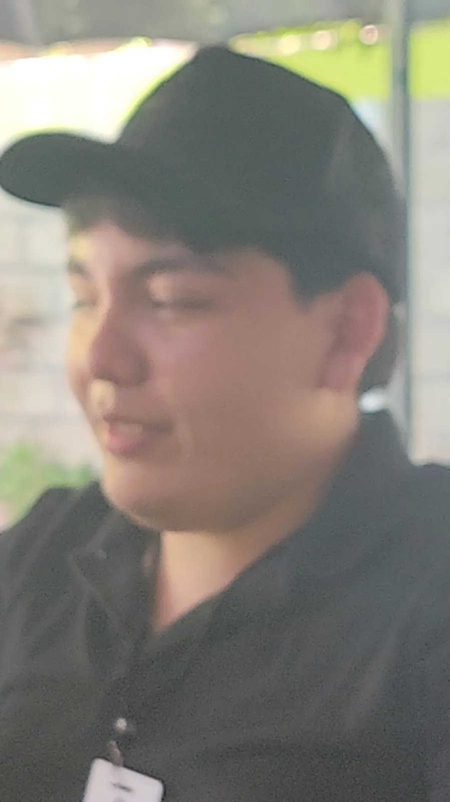

<h1 align="center">Flappy Pastrana</h1>

<p align="center">
  <em>Un arcade de vuelo infinito con un jefe que no piensa rendirse.</em>
</p>

<p align="center">
  <a href="https://unity.com/"></a>
  <a href="https://docs.unity3d.com/Packages/com.unity.render-pipelines.universal@17.6/manual/index.html"></a>
  <a href="https://docs.unity3d.com/Packages/com.unity.inputsystem@1.20/manual/index.html"></a>
  <a href="https://github.com/Chr111111s/flappyberdon/commits/main"></a>
  <a href="https://github.com/Chr111111s/flappyberdon"></a>
</p>

---

## Descripción

**Flappy Pastrana** es un juego 2D estilo *Flappy Bird* desarrollado en Unity con el
Universal Render Pipeline. El mundo completo (jugador, tubos, suelo, nubes, partículas,
interfaz y jefe) se **construye en tiempo de ejecución**: no hay prefabs ni objetos que
arrastrar en la escena. Al pulsar **Play**, `FlappyBootstrap` levanta el juego
automáticamente.

La dificultad escala con la puntuación: los huecos se cierran, la velocidad aumenta y un
**jefe perseguidor** aparece para complicar la huida.

<p align="center">
  
  &nbsp;&nbsp;&nbsp;
  
</p>

## Características

- **Vuelo con física propia**: gravedad, impulso de aleteo, inclinación y retroceso al golpear.
- **Dificultad progresiva**: velocidad y tamaño del hueco se ajustan según el puntaje.
- **Jefe perseguidor** con brillo, anillo y animación de aparición.
- **Récord persistente** guardado con `PlayerPrefs`.
- **Audio sintetizado en runtime**: aleteo, punto, impacto y jefe, sin assets externos.
- **Partículas procedurales** para el rastro y los efectos.
- **Interfaz completa**: menú, pausa, fin de partida y aviso de nuevo récord.
- **Multientrada**: teclado, ratón/táctil y gamepad.
- **Parallax** de nubes y marcas del suelo.

## Controles

| Acción | Teclado | Ratón / Táctil | Gamepad |
| :--- | :--- | :--- | :--- |
| Aletear / confirmar | `Espacio`, `W`, `↑`, `Enter` | Clic / toque | Botón Sur, `Start` |
| Pausa | `Esc`, `P` | — | — |
| Volver al menú | `M`, `Esc` | — | — |

## Tecnologías

| Herramienta | Versión |
| :--- | :--- |
| Unity | `6000.6.2f1` |
| Universal Render Pipeline | `17.6.0` |
| Input System | `1.20.0` |
| uGUI | `2.6.0` |
| Lenguaje | C# |

## Estructura del proyecto

```text
flappyberdon/
├── Assets/
│   ├── Scenes/            # Escena de ejemplo (el juego se genera en runtime)
│   ├── Scripts/           # Lógica del juego en C#
│   ├── Settings/          # Perfiles URP, input actions y volumen
│   ├── Resources/         # Retratos cargados en runtime
│   └── assets/            # Arte original (Pastrana y el jefe)
├── Packages/              # Dependencias del proyecto
├── ProjectSettings/       # Configuración del editor y del juego
└── .gitignore             # Plantilla oficial de Unity
```

> Se versionan únicamente `Assets/`, `Packages/`, `ProjectSettings/` y los archivos
> `.meta`. Las carpetas generadas (`Library/`, `Logs/`, `Temp/`, `UserSettings/`) y los
> archivos de IDE (`*.csproj`, `*.slnx`, `.vscode/`) quedan excluidos.

## Puesta en marcha

1. Clona el repositorio:

   ```bash
   git clone https://github.com/Chr111111s/flappyberdon.git
   ```

2. Abre la carpeta del proyecto con **Unity `6000.6.2f1`** desde Unity Hub.
3. Abre `Assets/Scenes/SampleScene.unity` y pulsa **Play**.

No hace falta configurar la escena ni asignar componentes: todo se crea al iniciar.

## Arquitectura

| Script | Responsabilidad |
| :--- | :--- |
| `FlappyBootstrap.cs` | Arranca el juego automáticamente tras cargar la escena. |
| `FlappyGame.cs` | Núcleo: estados, dificultad, tubos, jefe, puntaje y récord. |
| `GameView.cs` | Generación de sprites y construcción visual del mundo. |
| `GameUI.cs` | Menú, HUD, pausa y pantalla de fin de partida. |
| `InputHelper.cs` | Abstracción de entrada (teclado, puntero y gamepad). |
| `PipePair.cs` | Comportamiento y reciclaje de cada par de tubos. |
| `Sfx.cs` | Síntesis y reproducción de efectos de sonido en runtime. |
| `SimpleParticles.cs` | Sistema ligero de partículas procedurales. |

## MCP for Unity (opcional)

El proyecto puede conectarse a un asistente de IA mediante
[MCP for Unity](https://github.com/CoplayDev/unity-mcp), lo que permite inspeccionar
escenas, crear objetos o depurar la consola desde el chat. **No es necesario para jugar**
ni sustituye al control de versiones: los cambios de la IA siguen requiriendo
`git add`, `commit` y `push`.

## Créditos

- Personajes basados en las imágenes incluidas en `Assets/assets/`.
- Plantilla de `.gitignore`: [github/gitignore](https://github.com/github/gitignore/blob/main/Unity.gitignore).
